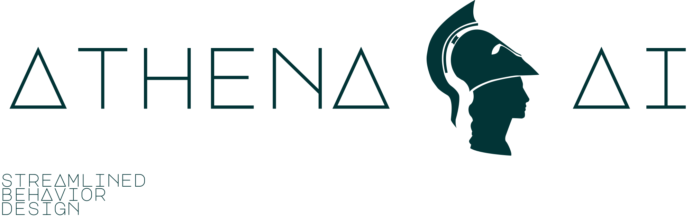

➡ [<u>Showcase video.</u>](https://youtu.be/u1A513igqlw)

➡ [<u>Playable demo.</u>](https://drive.google.com/file/d/1akM_Hh_LD300dS-Wv6K0JEVYvpHJ6VzH/view?usp=sharing)

➡ [<u>Demo Project.</u>](#kix.azei8mix2su3)

Athena AI version: 2.6

[<u>Changelog</u>](#changelog.)

© 2024 Iuliu Balean.

All rights reserved.

# Index

[Index 1](#index)

[Developer note 3](#developer-note)

[1. Introduction 4](#introduction)

> [1.1 What is Utility AI? 4](#what-is-utility-ai)
>
> [1.2 Key Concepts. 6](#key-concepts.)
>
> [1.3 Athena AI overview 7](#athena-ai-overview)
>
> [1.4 Athena AI architecture 9](#athena-ai-architecture)
>
> [1.5 Demo Project. 10](#demo-project.)
>
> [1.5.1 Shooter level. 12](#shooter-level.)
>
> [1.5.2 Stress Test level. 13](#stress-test-level.)
>
> [1.5.3 Life Simulation level. 14](#life-simulation-level.)
>
> [1.5.4 RTS level. 15](#rts-level.)

[2. Athena AI Component. 16](#athena-ai-component.)

> [2.1 Overview 16](#overview)
>
> [2.2 Setup. 17](#setup.)
>
> [2.3 Functions. 19](#functions.)
>
> [2.4 Delegates/Events. 22](#delegatesevents.)
>
> [2.5 Dynamic Pawn possession. 23](#dynamic-pawn-possession.)
>
> [2.6 Score pausing 23](#score-pausing)

[3. Agent Preset. 24](#agent-preset.)

> [3.1 Overview. 24](#overview.)
>
> [3.2 Setup. 25](#setup.-1)
>
> [3.3 Functions. 26](#functions.-1)
>
> [3.4 Tags and naming. 27](#tags-and-naming.)
>
> [3.5 Switching Presets. 28](#switching-presets.)

[4. Considerations Curve Table. 29](#considerations-curve-table.)

> [4.1 Overview. 29](#overview.-1)
>
> [4.2 Setup. 30](#setup.-2)
>
> [4.3 What is a Curve? 31](#what-is-a-curve)

[5. Data Manager. 32](#data-manager.)

> [5.1 Overview. 32](#overview.-2)
>
> [5.2 Functions. 33](#functions.-2)
>
> [5.3 Considerations. 37](#considerations.)
>
> [5.2.1 Dynamic Considerations. 38](#dynamic-considerations.)
>
> [5.2.2 Consideration Evaluators. 38](#consideration-evaluators.)
>
> [5.2.3 Evaluator Context. 39](#evaluator-context.)

[6. Tasks. 42](#tasks.)

> [6.1 Overview. 42](#overview.-3)
>
> [6.1.1 Properties. 43](#properties.)
>
> [6.2 Setup. 45](#setup.-3)
>
> [6.3 Events. 46](#events.)
>
> [6.4 Functions. 47](#functions.-3)
>
> [6.5 Task Locking. 48](#task-locking.)
>
> [6.6 Task Momentum. 49](#task-momentum.)
>
> [6.6.1 Task Momentum Properties. 50](#task-momentum-properties.)
>
> [6.7 Fallback Task. 51](#fallback-task.)
>
> [6.8 Behavior Tree Tasks. 52](#behavior-tree-tasks.)
>
> [6.9 Action Sequence Tasks. 53](#action-sequence-tasks.)
>
> [6.9.1 Actions. 54](#actions.)

[7. Services. 56](#services.)

> [7.1 Overview 56](#overview-1)
>
> [7.1.1 Properties. 57](#properties.-1)
>
> [7.1.2 Conditions. 57](#conditions.)
>
> [7.2 Setup. 58](#setup.-4)
>
> [7.3 Events. 59](#events.-1)

[8. Athena AI Interface. 60](#athena-ai-interface.)

> [8.1 Overview. 60](#overview.-4)
>
> [8.2 Setup. 61](#setup.-5)

[9. Debugging. 62](#debugging.)

> [9.1 Overview. 62](#overview.-5)
>
> [9.2 Debug Component. 62](#debug-component.)
>
> [9.3 Debug Widget. 64](#debug-widget.)
>
> [9.4 Player Debug Tool. 65](#player-debug-tool.)
>
> [9.4.1 Functions. 67](#functions.-4)
>
> [9.5 Visual Logger 69](#visual-logger)
>
> [9.6 Gameplay Debugger 71](#gameplay-debugger)
>
> [9.7 Unreal Insights. 72](#unreal-insights.)

[10. C++. 73](#c.)

[11. Multiplayer. 74](#multiplayer.)

[Appendix. 75](#appendix.)

> [Conventions 75](#conventions)
>
> [Notes on usage. 76](#notes-on-usage.)
>
> [Athena and GAS 77](#athena-and-gas)
>
> [Known issues. 79](#known-issues.)
>
> [Changelog. 80](#changelog.)

# 

# Developer note

Welcome to Athena AI.

My name is Iuliu and I designed this system with the idea of it being a streamlined solution that enables you to create emergent, and advanced AI behaviors easily.

With this manual, I hope to give you all the information you need to use and expand on the system, adapt it to your own needs and have a great experience overall while using it.

Even though the manual aims to be as clear and comprehensive as possible, sometimes you might need additional help or just want to know more. Head up to my [<u>Discord</u>](https://discord.gg/3zHVDevAFr) and let’s have a chat!

In Discord you can get more involved with the system, talk with other devs using Athena AI, suggest new features and be the first one to know about new releases..

Additionally, I placed various symbols throughout the manual to help you get important information quickly and give you some tips and tricks. These are:

Tips & Tricks 💡

Warning ⚠️

Important ❗

Lastly, I would like to express my sincere gratitude to each and everyone one of you who has chosen Athena AI. Your support and trust in this system makes it possible to continue its development and improvement.

Creating Athena AI has been a labor of love and your decision to integrate it into your projects is both humbling and very exciting.

Thank you for being part of this journey.

Warm regards,

Iuliu Balean

# 1. Introduction

## 1.1 What is Utility AI?

In video game AI, there are multiple ways of creating behaviors for non-playable characters (also called agents), such as:

- Behavior Trees.

- State Machines.

- State Trees.

- Custom AI solutions.

Some are well known tools for creating AI behavior however, there is no *one size fits all*, these solutions are often mixed together in a project. Even then, the result usually limits emergent behavior and that is where Utility AI shines.

A Utility AI System is just a different way of modeling AI behaviors, based on formulas, curves and tasks. Let’s see an overview of how it works:

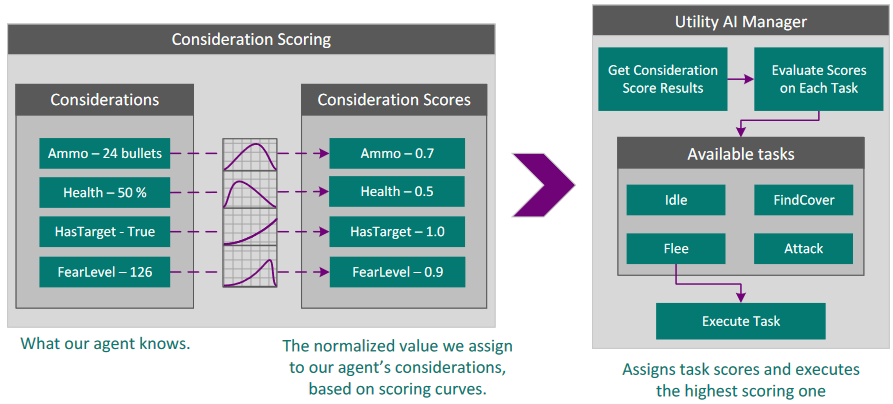

*Utility AI Overview.*

In this example, since our agent’s fear level is very high, it decided to flee as that task had the highest utility (score) in its current situation.

With Utility AI, a designer does not specify when an agent performs a task or action but what conditions are needed for it to be more likely to be executed, the system takes care of the rest. As you can already begin to see, this system lends itself to creating emergent behavior but more on that later.

To understand this concept in a practical way, let’s see some examples:

1.  We have a guard patrolling but is scared easily. So when he sees the player, most of the time he would run away , like in our previous example, but there is a small chance he will stay and fight, which might catch the player by surprise.

2.  A good example of Utility AI is The Sims, where you can leave your Sim unattended and they will just do their own thing based on their personality, needs and emotions, without having a designer specify what task should be done at a specific time.

3.  Similarly, we can look at other games like Halo Infinite, where bots present human-like behavior using a Utility AI system.

4.  Alien Isolation is another great example. Not only does the alien have very complex behavior but all that complexity is encapsulated in various mixed layers of a Behavior Trees and Utility AI.

💡 If you want to delve deeper into the way Utility AI works, you can find more information [<u>here</u>](https://medium.com/@morganwalkupdev/ai-made-easy-with-utility-ai-fef94cd36161) and [<u>here</u>](http://www.gameaipro.com/GameAIPro/GameAIPro_Chapter09_An_Introduction_to_Utility_Theory.pdf). I would also recommend watching [<u>this</u>](https://www.gdcvault.com/play/1021848/Building-a-Better-Centaur-AI) GDC talk on the topic and also [<u>this</u>](https://www.youtube.com/watch?v=H6QEpc2SQiY) one.

## 1.2 Key Concepts.

➡ Considerations: You can think of a consideration as a more complex input, where instead of using a boolean to determine if we do this or that, we do it using a raw numeric input (float).

These inputs are then normalized to the range of 0-1 and then processed through a curve, which will give us the final score.

➡ Curves: Curves are used to process considerations. They will remap the consideration value into a new value, again normalized, based on the curve keys.

➡ Scores: Scores for tasks are calculated taking into account the score of each consideration, after being processed by its curve. The result is then assigned to the task that is using these considerations.

➡ Tasks: These are our actions, the logic that our agent will do.

As an example, let’s imagine we have an agent with the considerations Hunger and Fatigue. As our agent gets hungrier, increasing the Hunger value, we want it to look for food, which is our task.

Now, if our agent is fatigued, we prefer to sleep instead, our second task. We can do this by modifying the curves of our considerations so that the result gives a higher score to sleep, even if our hunger consideration is very high.

In the end, our agent will eat when hungry but if it’s too sleepy, it will prefer to sleep till it recovers some energy and then it will eat.  
  
With more complex considerations and tasks, it will become more difficult to predict exactly what our agent will do, we can only push it towards certain tasks.

This is where emergent behavior is created, when our agent, having certain priorities, will behave in unexpected ways if the conditions are right.

With all this out of the way, let’s see how Athena AI works.

## 1.3 Athena AI overview

Athena AI is my take on Utility AI, born from the need to solve the many problems I’ve encountered while developing AI for my games.

Some of the most notorious ones are:

- Complex Behavior Trees. With the way BTs work, it’s very easy to add complexity and it gets out of hand very quickly. Adding a single new task can be a monumental endeavor in an already complex tree.

- Difficulty setting up. There are alternatives to the usual BTs or State Machines we all know and love but most of them are difficult to set up and sometimes, not really worth the hassle of doing it.

- Lack of flexibility. While other systems may work, there is usually a rigid structure that comes with them, making them less flexible and…

- Difficulty integrating in existing projects or with UE’s Systems. Some systems claim to be the *end all be all* solution but we already know there is no such thing so it’s important they are easy to integrate and work well with already existing systems.

Athena AI is not just an attempt to solve these issues but to expand on the Utility AI concept and make complex AI behavior easily attainable.

So, what can Athena AI do for you?

It will give you the tools to easily create your own AI behaviors while managing everything under the hood so you only have to worry about feeding it data about your agent’s environment and tasks to do, that’s it.

To achieve this, Athena AI features:

- Effortless implementation in any project. Just add the Athena AI Component to your Controller and you are almost ready to go.

- Centralized Preset System. Everything is in one place, your agent preset. No need to modify your controller BPs or go agent by agent. You can easily set up multiple agent presets, reuse tasks, create new behaviors, etc.

- Easy integration with UE’s systems. Athena AI is purposely built to integrate seamlessly with other Unreal tools, such Behavior Trees, which you can run directly from your Athena AI Behavior Tree tasks.

- Built for performance. Built completely on C++, Athena AI provides an efficient system that is both easy to maintain and debug, while being a powerful AI framework for developers and designers alike.

- Designer-friendly Blueprint support. Athena AI is not just for programmers, it is fully supported and exposed to Blueprints making it accessible to everyone. You will not need to go into C++ code to use it.

- Flexibility by design. There is no limit to what you can do with Athena AI. It is completely flexible and easy to use not just for AI agents but for orchestrators, squad leaders for a group of agents, etc.

- Scalable and decoupled architecture. As your project grows, the system remains flexible and easy to extend. From custom tasks to new types of agents or presets, it is made with expandability in mind.

- Flexible debug tools. Athena AI not only gives you debug tools but also empowers you to make them your own and integrate them seamlessly into your own custom HUD.

- Future development. With many features already planned and in the works, Athena AI will keep growing and becoming more feature rich.

> Check the [<u>Changelog.</u>](#changelog.) to see the progress.

As you go through the manual, you will get an understanding on how all these features work but before doing that, let’s take a quick look at the architecture of Athena AI and some of the most important components that make it all work.

## 1.4 Athena AI architecture

The Athena AI system is composed of many different components that work behind the scenes to create your desired AI behavior. The main ones are:

- Athena AI Component. The main component of the system and the one you will need to add to your AI Controller.

- Data Manager. Manages scores and considerations.

- Preset. Contains the information defining your agent’s behavior.

- Task. The logic and actions your agent will do.

- Service. A tool used to gather additional data only at specific moments or when certain conditions are met.

- Curve Table. This is where you define what each consideration means for your agent and how to score it.

Additionally, there is also a Debug Component you can place on your agents.

Let’s take a look at the system overview:

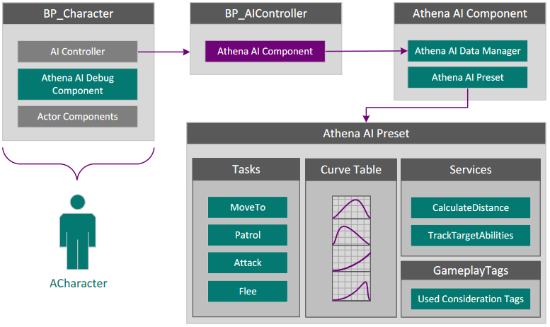

*Athena AI Architecture.*

## 1.5 Demo Project.

The Athena AI demo project will help you get a head start by giving you various examples on how it’s used and how to set it up.

You can use it just to understand how everything fits together or as a good foundation for your own project.

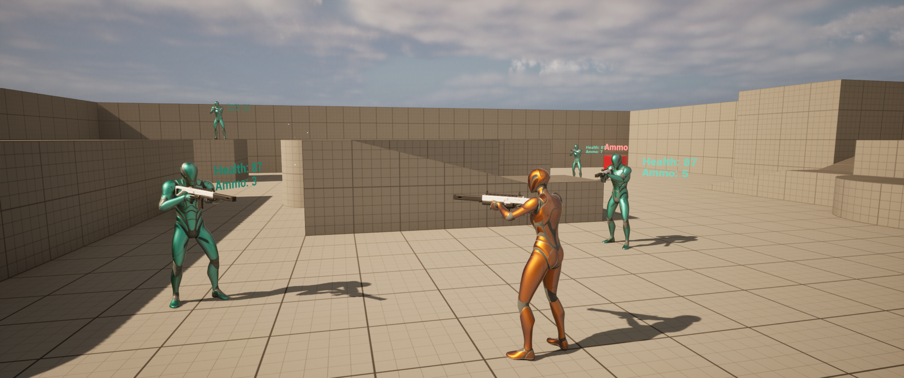

*Athena AI Demo Project.*

It is made with the idea of being an interactive course for you, so everything is laid out in Blueprint without functions containing additional logic or any other kind of abstraction. What you see is exactly what it needs to function the way it does.

Everything is commented and color coded for easy readability.

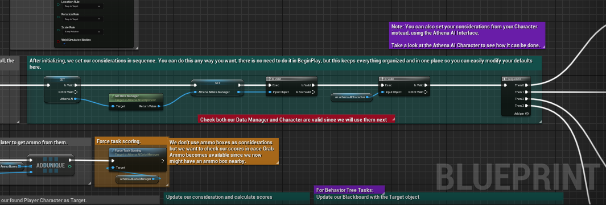

*Athena AI Demo Project Blueprint example.*

With that in mind, it can still be a bit overwhelming at first, especially if you are new to Utility AI, so I recommend going through the project in the following order to get the most out of it.

Start with the Shooter demo and take a look at:

1.  BP_AthenaAIController.

2.  BP_AthenaAICharacter.

3.  Presets/AthenaAIDemoPreset.

4.  Tasks/… Check each task starting with the Fallback Task.

5.  Services/AS_CheckDistance.

6.  BP_AthenaAIPlayer.

7.  AthenaAI_NodeOverview.

The color coding is:

- Title and explanation.

- Athena AI logic.

- Tips & Tricks/Additional options/General notes.

- Warnings/Important to keep in mind.

- Important notes.

- Non-Athena AI related/Generic UE logic.

To download the Athena AI demo project, please verify your purchase by contacting me either via [<u>Discord</u>](https://discord.gg/3zHVDevAFr) or the [<u>support mail</u>](mailto:contact@iuliubalean.com) with your purchase receipt.

The project is made in the last stable UE version.

❗ Athena AI must be installed into your engine to open the project.

You can alternatively try the playable demo, [<u>here</u>](https://drive.google.com/file/d/1akM_Hh_LD300dS-Wv6K0JEVYvpHJ6VzH/view).

⚠️ If you want to migrate the demo project into your own, remember to also copy the Gameplay Tags it uses, either doing it inside the editor or just copying the ones in the DefaultTags.ini file to your projects tags ini file.

### 1.5.1 Shooter level.

The Shooter level is the one that is loaded by default. It contains a small level with patrolling enemies that will shoot you on sight.

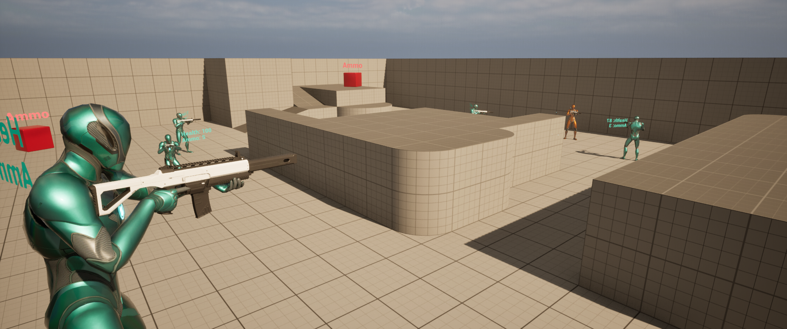

*Athena AI Demo Project - Shooter level.*

They have health and an ammo counter. When their ammo gets low, they will look for the red boxes that contain ammo and go get some.

As you damage them, they will try to heal but if you are close to them, they might instead flee and then heal.

The player has infinite ammo and health.

You can watch a short clip showcasing this level [<u>here</u>](https://youtu.be/GRuFPuUwFgk).

### 1.5.2 Stress Test level.

The demo project also comes with a stress test level with 100 agents using the Athena AI system, doing the same tasks and calculating scores as usual:

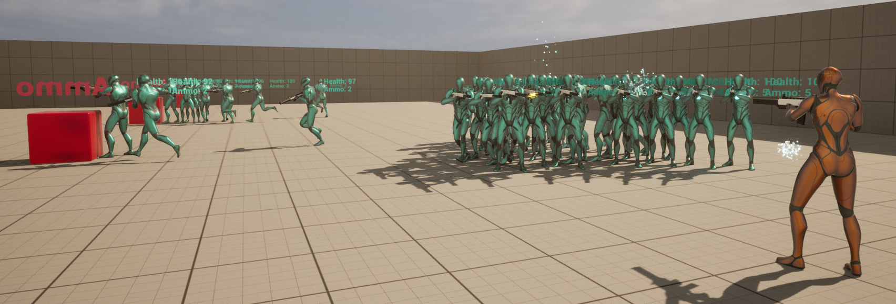

*Athena AI Stress Test level.*

Because of the UE5 mannequin graphical complexity and animations, you might notice slight performance deterioration. Scalability is set to medium in the project.

Some quick notes on performance:

➡ The agents in the stress level are patrolling and fleeing using a Behavior Tree task, which means Athena AI is running and a Behavior Tree is also running on each agent at the same time.

➡ Once the agents see the player, a service will start running, calculating the distance every 0.2 seconds, which also recalculates task scores.

With all that in mind, the system is still performant and with some slight optimizations when using it, it can easily handle 100+ agents at 60+ fps on packaged games.

You can watch a clip of the stress test level [<u>here</u>](https://www.youtube.com/watch?v=w2ViU88O2oU).

See [<u>Notes on usage.</u>](#notes-on-usage.) for insights on how to optimize it further.

### 1.5.3 Life Simulation level.

The Life Simulation level contains various platforms with agents trying to survive against the worst enemy of all, time.

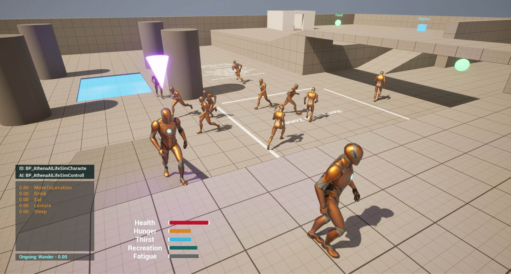

*Athena AI Life Simulation level.*

Each agent has their own needs: Hunger, Thirst, Recreation and Fatigue.

As their needs get lower, they will try to replenish them by doing various tasks that increase them such as eating/drinking, sleeping or enjoying themselves in the recreation zone.

If any of their needs, besides recreation, gets to 0, they will start losing health and will eventually die.

As the player, you will oversee everything from above but can also select any of the agents.

When selected, you will follow them and see their Athena AI panel and their needs as well as being able to order them to move around.

You can watch a showcase of this level [<u>here</u>](https://youtu.be/Y7LWIMGv_9I).

### 1.5.4 RTS level.

The RTS level is the most complex of the 4 demo maps.

In this demo, you not only have individual units using Athena AI but also a Commander controlling all of them, also using Athena AI.

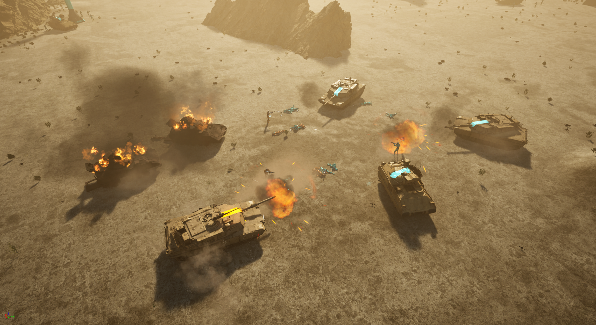

*Athena AI RTS level.*

In the RTS level you will take control of an HQ that can produce 3 unit types: Soldiers, IFVs and Tanks.

Each unit has its own advantages and disadvantages but soldiers have the ability to capture towers, which are critical as they increase your resource income.

Your HQ and the enemy HQ also produce resources at a constant rate.

The enemy Commander will create units and form squads to do various tasks, such as capturing resource towers, eliminating the threat in certain areas and attacking your HQ.

The way either of you win is by blocking the ability of the other faction to produce units, which is done by keeping units inside the other faction’s base.

More details in the project itself.

Check out the teaser trailer [<u>here</u>](https://youtu.be/iuw3IgX0YzY).

# 2. Athena AI Component.

## 2.1 Overview

The Athena AI Component is the backbone of the Athena AI system and the only thing you need to add to your AI Controller. It is an Actor Component.

Its main duties are:

➡ Initialization: It’s what constructs and initializes everything that is needed for the system to work.

➡ System entry point: This component is what you need to use in order to get into the system for all the other functions.

➡ References: Holds references to all the involved actors, components and objects that make the system work, which you can get from it.

➡ Utility functions and delegates/events: Contains functions that you might want to use in specific cases, such as ForceTaskScoring or ForceTaskStart, as well as delegates/events such as OnTaskStarted or OnTaskEnded.

➡ Debugging: Handles Visual Logger snapshots as well as most of the logging (logging related to scores and Considerations is done on the Data Manager). For more information on debugging, check [<u>8. Debugging.</u>](#debugging.)

➡ Termination: Handles uninitialization and cleanup.

You won’t need to interact much with the Athena AI Component in most cases, since it’s designed to work by itself.

## 2.2 Setup.

Since it’s an Actor Component, you will need to add it to your AI Controller BP:

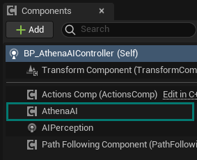

There is no setup required for it, you only need to add it and it’s almost ready to go.

It is also possible to add it directly in C++, on your Controller’s constructor.

*Adding the Athena AI Component.*

There are some things to keep in mind:

⚠️ It can work with an AIController child class/BP. If your class is not derived from it (such as Controller or Player Controller), it won’t initialize properly and will log an error.

❗ The system assumes you will use a Pawn subclass, so if your controller’s owned agent is not a Pawn, it won’t let you initialize it.

Once you have added your Athena AI Component to your AI Controller, there is only one thing left to you, adding your preset:

> *Adding Preset to Athena AI Component.*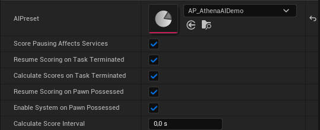

We will take a look at what the AI Preset is in section [<u>3. Agent Preset.</u>](#agent-preset.)

❗ The AI Preset is needed for the system to work. Without it, initialization will fail and the system will log an error.

There are also some options when setting up your Athena AI Component:

➡ Scoring options:

The properties for pausing and resuming scoring are explained in detail in section [<u>2.5 Score pausing</u>](#score-pausing) and unless needed for your specific case, you can leave them all with their default values.

➡ Enable System on Pawn Possessed:

Setting this to true will auto activate Athena AI as soon as your AI Controller possesses a new Pawn. If set to false, you will need to manually enable Athena AI using the Enable/Disable nodes found in the next section.

➡ Calculate Score Interval:

Setting it to anything other than 0 will calculate scores at the specified interval, even if you also calculate scores when updating some considerations.

This option is especially useful when dealing with a large amount of Considerations that are updated very frequently, as you can leave the score calculation to be done on this interval and not when updating Considerations.

⚠️ While this option can be very useful in some situations, it is not recommended to use when you are already calculating scores by updating Considerations frequently, as it can lead to an excessive and unnecessary amount of calculations.

## 2.3 Functions.

As mentioned before, you won’t be using the Athena AI Component directly in most cases, but you will use it to get references to the different parts of the system or for alternative ways of using it. These are its functions:

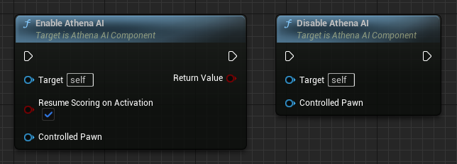

*Athena AI Component Enable/Disable Athena AI nodes.*

➡ Enable/Disable Athena AI nodes:

These nodes can manually enable or disable the system, stopping and resuming all AI logic.

If the system was enabled correctly, the Enable Athena AI node will return true.

In both cases, you can provide the Controlled Pawn or let the system get it automatically.

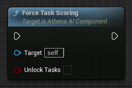

➡ Force Task Scoring:

Forces a task scoring calculation, even if considerations have not changed.

⚠️ Your current task will not be restarted if its the highest scored..

Set Unlock Tasks to true for all your tasks to be available before scoring them.

*Force Task Scoring BP node..*

💡 Use case: Your agent is updating lots of considerations all the time but you don’t want to calculate scores constantly. Use this at a set interval instead.

➡ Force Task Start: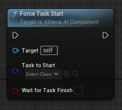

Forces a task to start, independently of the priority or score it has, even if the current task is uninterruptible.

⚠️If the task to start is locked, it will unlock it.

If Wait for Task Finish is true, it will pause scoring till this task ends.

*Force Task Start BP node..*

💡 Use case: The player reaches a threshold and something happens, be it a cinematic or any other event. You can force all the agents in a specific zone to do a custom task when this happens.

💡 Used in the Life Simulation level so the player can order agents to move.

Both of these nodes have functionality related to how tasks work, which is all described in section [<u>5. Tasks.</u>](#tasks.)

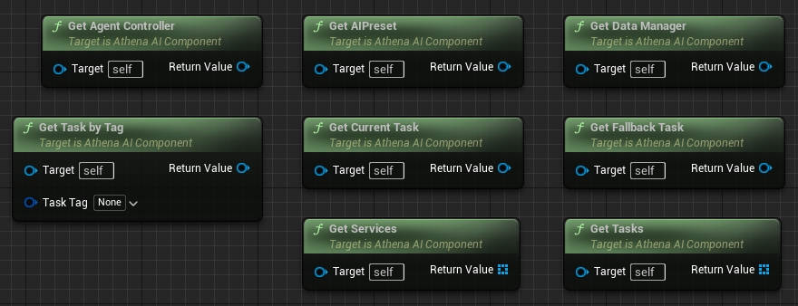

*Athena AI Component getter BP nodes.*

➡ Getter nodes for all references:

These nodes will return the different components and objects the Athena AI Component has access to.

Each component is described in its own section in this manual.

⚠️ The only node guaranteed to not be null is the Agent Controller but it could still be null if you put this component onto a non-AI Controller child class.

💡 Use case 1: The main use case is to get the Data Manager, which is used to update and store considerations for your agent.

💡 Use case 2: An agent could get another agent’s preset as a way to identify it. For example, the agent could ask, how many Defensive agents are around me? It could then verify this by getting their preset and checking their names.

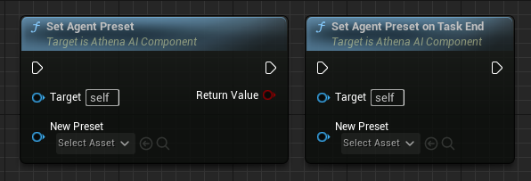

*Athena AI Component Set Preset BP nodes.*

➡ Preset switching functions:

These nodes are used to change your current agent’s Preset either immediately or when the current task ends.

More details about Preset switching in [<u>3.5 Switching Presets.</u>](#switching-presets.)

## 2.4 Delegates/Events.

The Athena AI Component contains a couple delegates/events that you can use while running the system for different purposes.

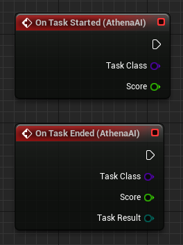

➡ OnTaskStarted:

Will be called as soon as a new Task starts, returning the Task Class and the score at that moment.

➡ OnTaskEnded:

Same as the above only it will be called just after the Task ends. Also returns its class and score at that moment but will also return the Task Result, which indicates how and why the Task ended.

The Task Result enum can be:

➡ Successful: Indicates the Task has finished successfully either by using the FinishTask node or because the system ended the current Task to prepare for a Preset change or because it was disabled.

➡ Replaced: It means a new Task was chosen and it replaced this one.

➡ Aborted: Indicates the Task was aborted by using the Abort node, which would usually indicate failure in Task logic as well as locking the Task.

➡ Failed: It will only return Failed if the Task failed to start properly. This could mean a Task with Tick enabled but no Pawn or BT Task with no BT, etc.

💡 Using these delegates allows for multiple new options like giving orders that allow your agent to do other Tasks in between. This can be done by storing your order (Task class) and checking if they have an order (your stored task class) pending when the current Task, which could be another task, ends.

## 2.5 Dynamic Pawn possession.

With Athena AI, you can dynamically swap your controller’s possessed pawns.

You just need to proceed as you would with your normal unpossess and possess logic for your controller and the Athena AI Component will manage this for you.

⚠️ After a successful possession, even though your data manager will still have its considerations, their value and range will be reset back to the system defaults.

⚠️ If spawning Pawns during gameplay, make sure the Auto Posses AI option in the details panel is set to either “Spawned” or “Placed in World or Spawned”, unless you spawn your controller manually.

## 2.6 Score pausing

Scoring can be manually paused at any time using the Data Manager’s [<u>pausing and resuming functions</u>](https://docs.google.com/document/d/123MxeGCc001LCaXPwC1FVxV-Li_uJSbFHPIrMopDorg/edit#bookmark=kix.pb5ge0x9ccj8) but there are also ways to automatically resume scoring.

As we have seen in [<u>2.2 Setup.</u>](#setup.) we have some properties related to score pausing and score calculation on the Athena AI Component:

> *Score pausing properties.*

➡ Score Pausing Affects Services: When true, if scoring is paused, Service conditions will also stop being updated when a Consideration is updated.

➡ Resume Scoring on Task Terminated: If true, scoring will be automatically resumed when a Task is finished, no matter if it was aborted, failed or successful. Otherwise, you will have to manually resume scoring.

➡ Calculate Scores on Task Terminated: Related to the option above, this means if true, it will perform a score calculation when the current Task ends.

➡ Resume Scoring on Pawn Possessed: Similar to the above but in this case, scoring will be resumed once a new Pawn is possessed.

# 3. Agent Preset.

## 3.1 Overview.

The Agent Preset is a Data Asset where we put everything together for our agent.

It is used when initializing the system and is necessary for it to work.

Using presets allows for flexibility and reusable tasks, services and curves, reducing the amount of redundant work.

Presets are semi-automated, meaning they will do some of the bulk work for you, like generating curves and showing you the considerations the preset will use.

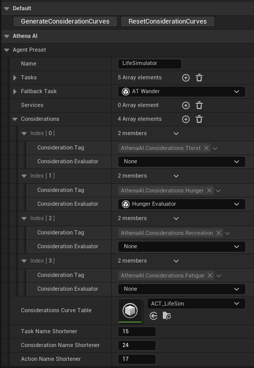

➡ Name: The name for this preset.

➡ Tasks: The tasks this preset has.

➡ Fallback Task: The task our agent will do if no other tasks are available.

➡ Services: The services this preset will grant to our Data Manager.

➡ Considerations: The considerations used on this preset and the Evaluators attached to them.

➡ Considerations Curve Table: The curve table used by the preset.

Different presets can use the same curve table.

> ➡ Naming shorteners: Take a look at [<u>3.4 Tags and naming.</u>](#tags-and-naming.) for details on this.

*Agent Preset overview.*

💡 Tasks and Services can be edited here, meaning different presets can use the same tasks but their settings can be different, which results in different behavior.

## 3.2 Setup.

To create an Athena AI Preset, you just need to create a Data Asset:

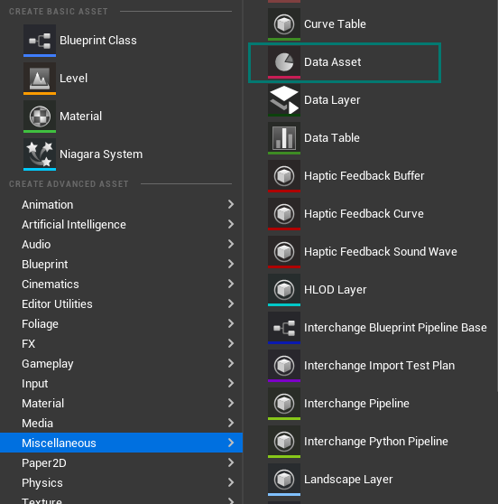

> *Creating a Data Asset.*

And use the Athena AI Agent Preset class:

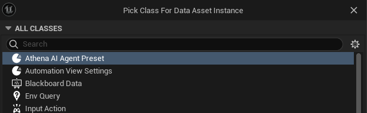

> *Choosing the Athena AI Agent Preset Data Asset class.*

Once done, you will be able to add your tasks, services and curves.

## 3.3 Functions.

Even though you won’t be interacting with the preset outside of the initial configuration, there are helper functions to make the configuration easier.

These functions are at the top of the preset panel:

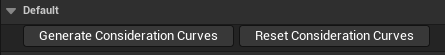

> *Athena AI Preset functions.*

➡ Generate Consideration Curves: It will generate the consideration curves you need based on the tasks you have on the preset. Curves come with 2 keys, at 0 and 1 (with values of 0 and 1) by default.

Every time you add or remove tasks, you can click it and it will update your curve table with the correct tasks. It is non-destructive so your curves won’t get deleted while working with it, just removed from the table.

💡 Curves are generated based on the task and consideration names. If you use the same task name, it will add a number at the end of it.

💡 If a Task is removed and then replaced by a new one with the same name (task name, not asset name), it will get the curves of the previous task.

➡ Reset Consideration Curves: It will remove all curves from the curve table.

⚠️ When using either one, your curve table should be closed for it to correctly update or remove the curves.

❗ DO NOT use Reset Consideration Curves with the curve table open, it will crash the editor since they are still being referenced by it when removing them.

➡ Update Consideration Tags:

Consideration tags are updated automatically as you add or remove tasks.

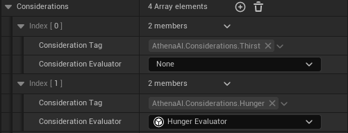

⚠️ If you modify a task outside the preset, you will need to add it again for it to update the Consideration tags.

## 3.4 Tags and naming.

As we explain in [<u>Conventions</u>](#conventions) Athena AI works assuming you are following the naming conventions for Tasks and Considerations when creating your tags.

You can also opt out of that and use your own naming and in that case, the Preset provides a handy way of unifying your naming inside the system so everything appears as you want it to.

To do this, we use the Task and Consideration shorteners on the Preset:

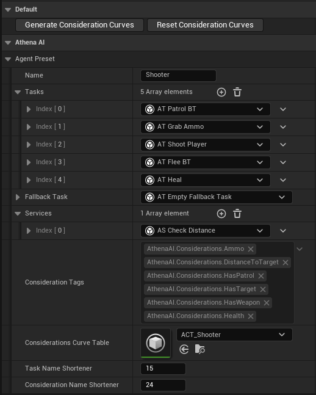

By default, Tasks use a 15 character shortener and Considerations use 24. This means your Curves, Debug Component and anything visual will use a shortened version of your tag name.

For example, if you generate curves for a Task with tag *AthenaAI.Task.Patrol* and has a Consideration with tag *AthenaAI.Consideration.HasPatrol*, you would not want the entire name in your curves since it would be messy and harder to read.

With the shorteners, by default, those names will result in just Patrol and HasPatrol since we are removing 15 characters from the Task tag (AthenaAI.Task.) and 24 from the Consideration tag (AthenaAI.Consideration.).

⚠️ Shorteners start from the left and include all special characters and spaces.

⚠️ Make sure you configure your shortener before you generate curves and if you change their length, you will need to generate curves again or manually adapt their names.

## 3.5 Switching Presets.

Presets can be switched during runtime. This allows you to quickly change your agent’s behavior to something completely different, with new tasks, services and completely different curves.

As we have seen, in [<u>2.3 Functions</u>](#functions.), we can use SetAgentPreset or SetAgentPresetOnTaskEnd to do this. Here’s an overview on how it works.

➡ Set Agent Preset:

Will change the Preset of the agent holding the Athena AI Component immediately, stopping any ongoing Tasks and Services.

➡ Set Agent Preset On Task End:

Same as the above only it will wait until the current Task finishes, either because of a score calculation or because it is manually finished/aborted, before starting the process.

While waiting for the current Task to end, you can still use Set Agent Preset to immediately change it in case of an event, like the player attacking the agent.

💡 Set Agent Preset On Task End could be used to provide a seamless experience for the player and other agents, avoiding sudden changes of Tasks and providing a more immersive experience.

💡 When switching Presets, your agent will retain their current Considerations if they are also used in the new Preset, so you will not need to update those or set their defaults again.

⚠️ While waiting for the current Task to finish, Force Task Start will be disabled.

⚠️ If the Pawn is unpossessed during the Set Agent Preset On Task End process, it will abort the Preset switch.

⚠️ If the Preset is not valid or has no Tasks, the operation will be aborted.

# 4. Considerations Curve Table.

## 4.1 Overview.

At the bottom of the preset, you will find your Considerations Curve Table. We use it to assign a value from 0 to 1 to our considerations, based on its curves.

In simple terms, they are a mix between a Data Table and curves but their purpose is completely different.

Curve Tables allow us to define scores for our considerations based on their values in a non-linear way. Athena AI makes heavy use of Curve Tables for all score calculations.

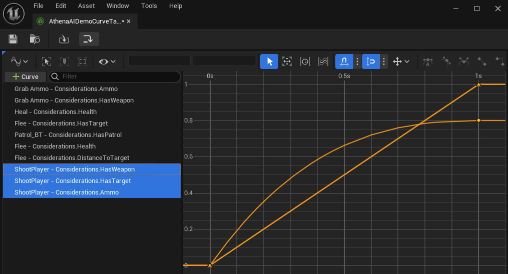

> *Athena AI Considerations Curve Table.*

💡 Curve Tables can be used for many different things and are a great tool for managing non-linear data. You can learn more about them [<u>here</u>](https://benui.ca/unreal/curve-tables/).

💡 Even though you can assign any value to a curve, results are clamped from 0.0 to 1.0, so going higher or lower than that will not do anything.

On the other hand, you could limit the score of a consideration by limiting how high the curve goes, 0.6 instead of 1.0, as an example.

## 4.2 Setup.

To create a Curve Table, you can find it in the Miscellaneous menu:

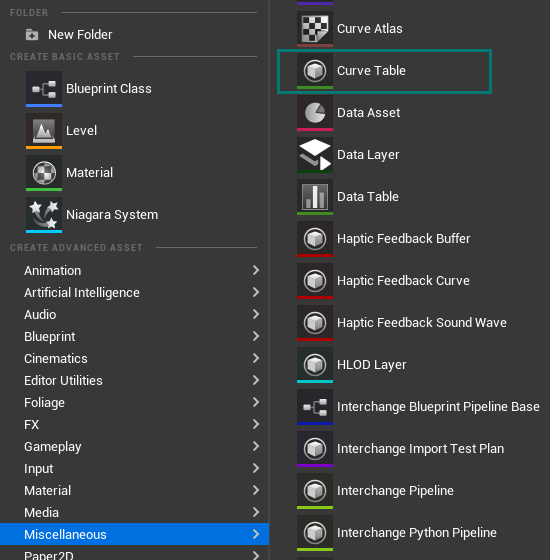

> *Creating a Curve Table.*

❗ Make sure you choose Cubic as your curve table interpolation type:

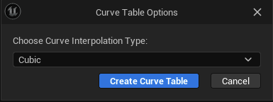

> *Creating a Curve Table - Choosing interpolation type.*

Once done, you are ready to generate curves from your Athena AI Preset.

## 4.3 What is a Curve?

A curve is just a way of defining two-dimensional numerical data, which means you define what the output would be when the input is x value.

The interesting feature curves have is…well, they are curves. So you don’t need to assign a value for every single input but you can use curves to interpolate between them and get your desired result in a non-linear way.

Let’s take a look at our Flee task, which has 3 considerations. You can select all of them to quickly understand what will happen:

➡ HasTarget: True (1.0) if our agent has a target.

➡ Health: The amount of health our agent has, normalized.

➡ DistanceToTarget: The distance to our agent’s target, calculated by a service.

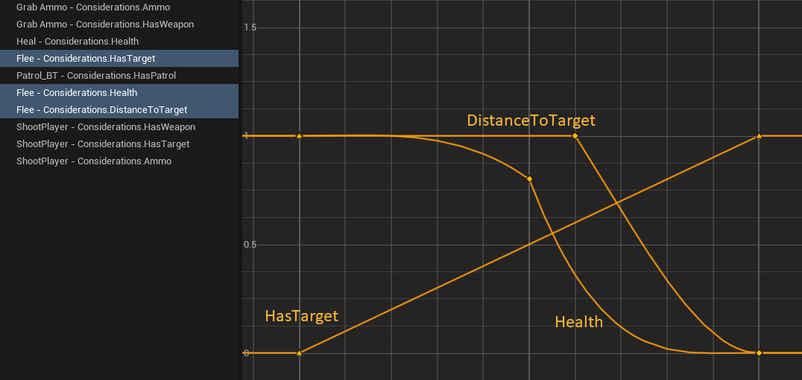

*Flee task consideration curves in the Considerations Curve Table.*

Let’s analyze the behavior for this task.

It will only output something other than 0 when HasTarget is true (1.0).

As Health gets lower, the score for this task gets higher.

As DistanceToTarget increases, the score for this task gets lower but only from a certain point. If too close, it will always output 1.0.

So in summary, our agent is more likely to flee when its health is lower and its target is closer.

# 5. Data Manager.

## 5.1 Overview.

While the Athena AI Component is the backbone of the system, the Data Manager is its brain. It is constructed by the Athena AI Component.

Its main duties are:

➡ Consideration management: It manages all the considerations, their current values as well as their range.

➡ Service management: Updates services when considerations are updated.

➡ Score calculation: It calculates the scores for each task.

💡 Since the Data Manager is constructed by the Athena AI Component, there is no setup needed.

The Data Manager can be accessed by getting it from the Athena AI Component directly or by using the Athena AI Interface on any Actor.

More on that in section [<u>7. Athena AI Interface.</u>](#athena-ai-interface.)

## 5.2 Functions.

The Athena AI Data Manager’s job is to manage considerations and score tasks, which means the functions available are all for that purpose:

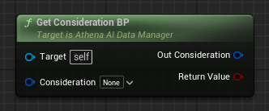

➡ Get Consideration BP:

Searches for a consideration by tag and returns it.

⚠️ Will return false if not contained in the Data Manager.

*Get Consideration BP Node.*

💡 Use case: A service that checks if the distance to target is above a threshold can do it by getting the consideration Max value from the Data Manager.

⚠️ Depending on the amount of considerations you have, this may be expensive.

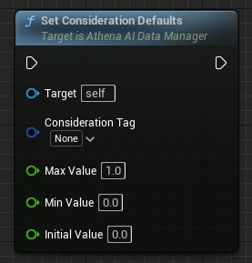

➡ Set Consideration Defaults:

Sets the Min/Max values and the initial value for a consideration.

This adds it to the considerations list for later use and will not calculate scores.

Min and Max values are used for normalization, so they are the range your consideration will use for example, min and Max Health.

💡 For bools, you can skip this step.

*Set Consideration Defaults BP Node.*

💡 Use case: Setting all your default values, like attributes, equipment, combat range, etc.

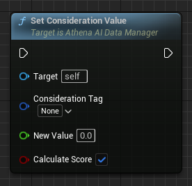

➡ Set Consideration Value:

Sets a value for a specific consideration, based on the tag.

⚠️If it is not found, it will create it.

It will use the min/max values set in the consideration.

Set CalculateScores to false if you want to update multiple values and only calculate scores on the last one.

*Set Consideration Value BP node.*

💡 Use case: Used in most cases where you will update a consideration.

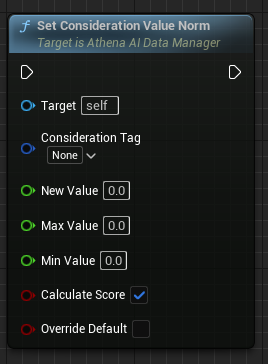

➡ Set Consideration Value Norm:

Sets a consideration value with a specific min and max value for normalization.

⚠️If it is not found, it will create it.

Set CalculateScores to false if you want to update multiple values and only calculate scores on the last one.

Set OverrideDefault to true if you want these new min and max values to override the saved ones and become the default ones.

*Set Consideration Value Norm BP node.*

💡 Use case 1: Used in any case where your range might vary, such as distances.

💡 Use case 2: Used for any attribute that might change as the game goes on, such as leveling up and increasing max health.

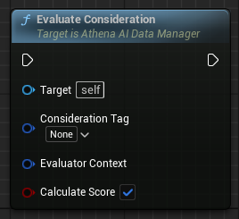

➡ Evaluate Consideration:

Runs the [<u>Evaluator</u>](#consideration-evaluators.) for this Consideration and inserts the result into the Consideration’s Raw Value, updating it.

A custom context can be provided. More on that in [<u>5.2.1 Evaluator Context.</u>](#evaluator-context.)

⚠️Normalization happens AFTER, so the min/max range should be provided before, if needed.

*Evaluate Consideration BP node.*

💡 Use case: Similar usage as SetConsiderationValue but this keeps your Consideration scoring logic separate from your main BP graphs.

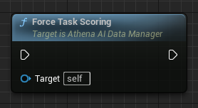

➡ Force Task Scoring:

Forces a task scoring calculation, even if considerations have not changed.

⚠️ Your current task will not be restarted even if it's the highest scored.

⚠️ If scoring is paused, you can’t force it.

*Force Task Scoring BP node.*

💡 Use case: You might update considerations without scoring them. In that case, use this in a set interval to score your tasks.

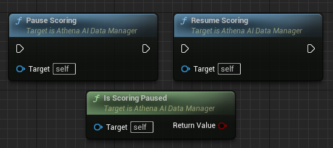

> Pause/Resume Scoring and Is Scoring Paused BP nodes.

➡ Pause/Resume Scoring:

Pause or resume the scoring for all considerations.

⚠️ Scoring will be automatically resumed once a task ends, unless set otherwise.

💡 Use case: Your character enters a cinematic while surrounded by enemies. Force an idle task on them and pause scoring. This will make sure they won’t do anything while the cutscene is running. Then resume scoring and force a calculation. The result tasks will be the same as before the cutscene.

➡ Is Scoring Paused:

Will return true if the scoring is paused.

💡 Use case: Don’t start the above cinematic unless scoring is paused on all agents in the nearby area.

## 5.3 Considerations.

As we explained in [<u>1.2 Key Concepts.</u>](#key-concepts.), we will use considerations in combination with our Curve Table to determine whether our agent will do one task or another.

Considerations in Athena AI are just float values, although you can use bool, int, double or similar when updating them.

Additionally, each consideration is represented by its own GameplayTag, which is used to identify it in the system and assign it to tasks and services.

💡 You don’t need any new data to use as considerations. If your agent is already tracking its attributes, target, equipment, etc. you can just plug that data directly into the system in most cases.

You can see below how updating considerations is not much different than updating a Behavior Tree Blackboard key, only it’s always a numeric value.

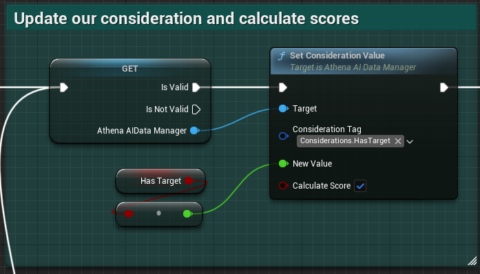

> *Updating a Consideration.*

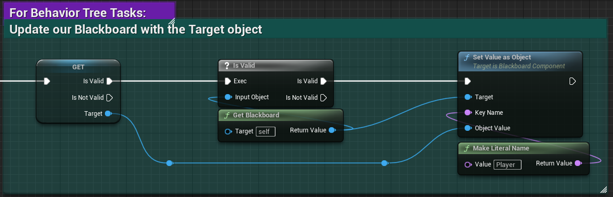

> *Updating a Blackboard key.*

### 5.2.1 Dynamic Considerations.

Dynamic Considerations function just like normal Considerations but the way they are calculated is different.

Instead of directly setting the value with *SetConsiderationValue*, they are updated using Evaluators, which are independent UObjects where you can set up your own calculation logic. Then call *EvaluateConsiderations* on the Data Manager, which will trigger the Evaluator to calculate your Consideration value based on your logic and seamlessly send it straight into the scoring pipeline.  
  
This keeps your Pawn/Controller classes much cleaner and your scoring logic all in one place.

### 5.2.2 Consideration Evaluators.

Evaluators are very light UObjects with only one purpose, to execute their logic when EvaluateConsideration is called and return the calculated value. They should not store or set any values by themselves.

💡 Since Evaluators are independent objects and not related to any specific Character or Preset, they can be used for multiple Presets and for different Considerations, provided the logic in them admits it.

To create an Evaluator, simply create a new Blueprint Class and pick the Evaluator as parent:

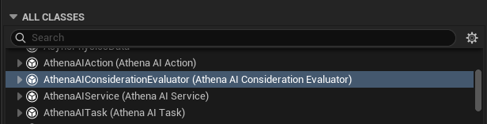

> *Evaluator BP Class creation*

The way they work is, initially, a *ShouldEvaluate* function is executed:

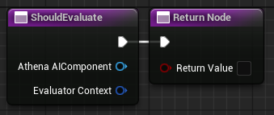

*Evaluator ShouldEvaluate BP function.*

This function is meant as an initial check, before you do any complex logic. By default it returns true, so usage is optional.

After that, if the return of *ShouldEvaluate* is true, *CalculateRawValue* runs. This is where you calculate and return the value of the Consideration.

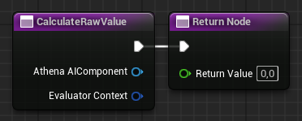

*Evaluator CalculateRawValue BP function.*

⚠️ Some notes on Dynamic Considerations vs using Services:

As pointed out in [<u>7. Services</u>](#services.), we could use a Service to calculate the Distance to a target or some other properties and update our Considerations.

This is still valid, only now you have the option to move the distance calculation logic, or any other logic, into your Evaluator and call *EvaluateConsideration* from the Service itself. So it’s still the Service that drives the updates, but you can now use the Evaluator from multiple other places and calculate your Consideration.

### 5.2.3 Evaluator Context.

As you have seen in all Evaluator related nodes and functions, a context can be sent when calling *EvaluateConsideration*.

This context is an instanced Struct of type *FBaseEvaluatorContext*. The struct can be used to make your own custom ones and store any types. This is a very flexible way of working since it allows you to essentially send exactly the needed data without having to communicate directly with an Evaluator, which avoids coupling or interfaces.

Multiple context types are provided by default with Athena:

➡ FTagEvaluatorContext: Holds a single tag as an event tag. It is used as base for the next structs, so all of them will include this event tag too.

➡ FActorEvaluatorContext: Holds 2 Actors, source and target.

➡ FLocationEvaluatorContext: Holds 2 location vectors, source and target.

➡ FNumericEvaluatorContext: Holds a single float value.

➡ FEventEvaluatorContext: Holds 2 actors, source and target, 2 vectors, location and direction, and a float as magnitude.

Here is an overview of all context types:.

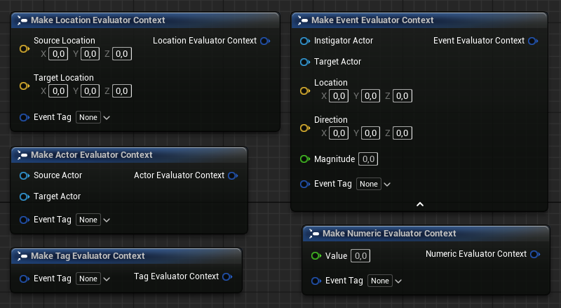

> *Evaluator Context types in BP*

You can create your own custom context in C++ by using the base struct *FBaseEvaluatorContext* or any other struct as parent. Unfortunately, that is not possible on BP.

As an example, we will go over how to use an Actor Evaluator Context, from the initial call to Evaluate Consideration, all the way to the Evaluator itself.

First, you need to make the struct and provide the needed inputs. You do not need to provide all of them, just the ones you will use.

To do that, use the *Make Instanced Struct* node and drag from the Value input pin. Then you can write Actor Evaluator Context and select the Make variant.

The result should be similar to this:

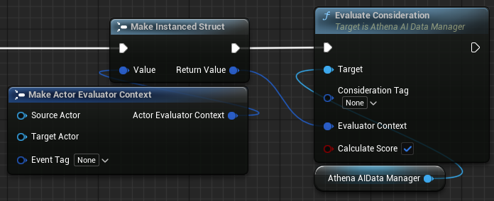

> *Evaluator Context setup in BP*

When Evaluate Consideration is called, it will send your custom context into the Evaluator that is assigned to that Consideration on the Preset.

To use your context, on the Evaluator you’ll need to use Get Instanced Struct Value and then drag the Value pin and select Break Actor Value Context (or any context you are using). A Not Valid output pin is also available if your context is not valid, of the wrong type, etc.  
  
It should look like this:

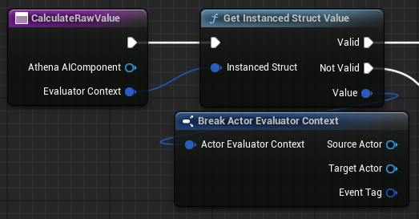

> *Evaluator Context usage in BP*

Now you’ll be able to use the context values to calculate the Consideration score.

# 6. Tasks.

## 6.1 Overview.

Tasks are the bread and butter of Athena AI and where you will define the logic for your agents.

Think of Tasks as actions your agent will do when their utility score is high enough.

Task logic is encapsulated in Blueprints, which will give you the flexibility you need to customize your AI behavior. That means, tasks can hold variables, references, can call events on other Blueprints, etc.

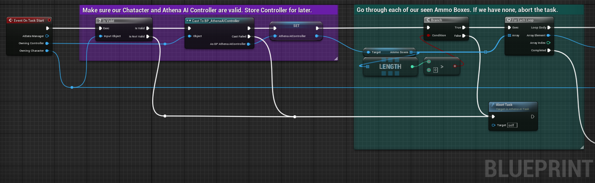

*Task example.*

### 6.1.1 Properties.

Each task has its own properties you can define in the Task panel:

➡ Task Tag: The tag (ID) for this task, also used for creating consideration curves in the curve table. 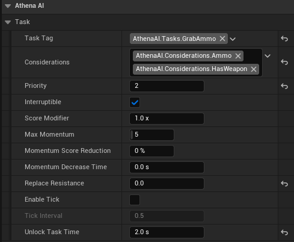

❗ Task tags must be unique. Otherwise, the first one found by the system on Preset load will be used, the rest will be ignored.

➡ Considerations: The considerations this task will use.

➡ Priority: Used to determine which task will be executed when multiple tasks have the same score.

*Task details panel.*

➡ Interruptible: Sets if this task can be interrupted by another one.

⚠️ Chose carefully when to set it to false since it may lead to a task being stuck.

➡ Score Modifier: A way to increase or decrease the score for this task on top of curves, as a multiplier. You can set the default here and set it dynamically on the task or by getting a reference to it from the Athena AI Component.

The score modifier can be used as a dynamic weighting system for your tasks. For example:

- Offensive soldier agent: Prefers offensive Tasks, so you assign more weight to them (1.2 or 1.3 for example).

- Defensive soldier agent: Prefers defensive Tasks, so you assign more weight to them.

- Passive soldier agent: Prefers to run away. So you assign less weight to offensive or defensive Tasks (0.8 or 0.7).

💡 You can access the current task or get any task from the Athena AI Component. Then you can easily modify the Task Score Modifier at any time.

➡ Momentum properties (Max Momentum, Momentum Score Reduction and Momentum Decrease Time): Used to avoid the same task being executed in a row because it’s always the best scoring one. Full details on the Momentum system and all its properties at [<u>5.6 Task Momentum.</u>](#task-momentum.)

➡ Replace Resistance: Sets the resistance a task has to being replaced by another one, i.e.: how much higher the score of the new task should be.

➡ Enable Tick: Tasks can have tick functionality, which means they will execute their tick in the frequency set by Tick Interval.

➡ Tick Interval: Sets the interval for the Tick event, in seconds.

⚠️ As with any tick function, don’t over use it, especially for heavy tasks.

➡ Unlock Task Time: Task locking is described in [<u>6.5 Task Locking.</u>](#task-locking.) This property sets how much time should pass till a task is unlocked, in seconds. If set to 0, it will only unlock after a different Task is successfully executed.

## 6.2 Setup.

To create a task, you just need to create a Blueprint Class and use any of the task classes as parent:

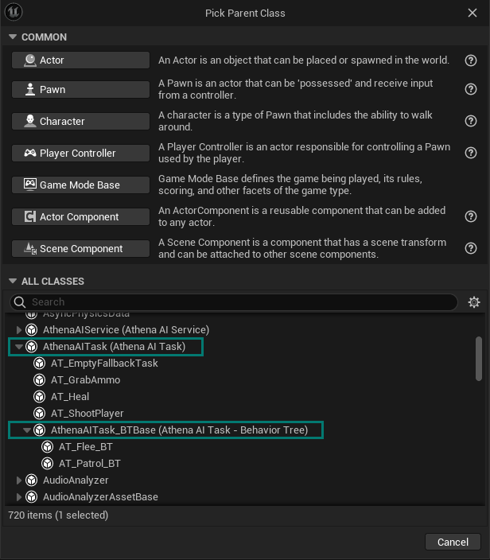

*Creating a task blueprint.*

## 6.3 Events.

Tasks have multiple events available. They are all called by the Athena AI system.

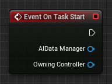

➡ On Task Start:

Called when the task is executed. Depending on your task, all your logic might only be here.

It also gives you references to your agent’s AI Data Manager and Owning Controller.

*On Task Start BP node.*

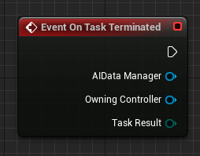

➡ On Task Terminated:

Called when the task has finished or was aborted.

It will also give you the task result, which can be Successful, Aborted or Failed.

Your cleanup, if needed, goes here.

*On Task Terminated BP node.*

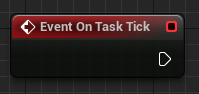

➡ On Task Tick:

Called with the frequency of Tick Interval.

⚠️ Task Tick must be enabled for this to be called.

*On Task Tick BP node.*

💡 Use case: A healing task might use Tick to replenish health every 0.2 seconds and update the Health consideration.

## 6.4 Functions.

Although Tasks are encapsulated in their own Blueprint and you will not interact with them directly in most cases, they still provide functions for flow control:

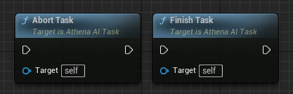

> *Task BP nodes.*

➡ Abort Task:

Aborts the task, handling internal cleanup and then triggering a score calculating for a new task to be executed.

⚠️ Aborting a Task will lock it. Task Locking is explained in [<u>5.5 Task Locking.</u>](#task-locking.)

➡ Finish Task:

Ends this task successfully, handling internal cleanup and then triggering a score calculation for a new task to be executed.

💡 Finishing tasks is not necessary in most cases since the agent will usually chose a new task and override the current one, finishing it successfully.

💡 When a task is finished, manually or by the system, it will unlock all locked tasks so they will be available again.

## 6.5 Task Locking.

Task locking is a mechanism Athena AI uses to deal with tasks that are not successfully executed to avoid getting stuck in a task and then triggering a score calculation that starts the same task again, which ends in a loop.

When a task is aborted, the system assumes it failed because something in its logic could not be handled, be it a null reference, an impossible path, etc.

When this happens, we usually want our agent to do something else and try this task again later.

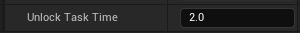

To do this, as we have seen in [<u>5.1.1 Properties.</u>](#properties.) We use the Unlock Task Time property.

*Unlock Task Time Task property.*

This property sets when this task will be unlocked, in seconds.

When set to 0, it will wait for a task to be successfully executed before unlocking this one.

💡 As we’ve seen in [<u>2.3 Functions.</u>](#functions.) forcing a task will unlock the task it's trying to execute.

⚠️ Task locking is a reliable way of dealing with task logic failing but it’s best to prevent it when possible, using considerations instead of checking everything in the task itself. Our agent should be already in the clear to do the task, not checking while is already doing it.

## 6.6 Task Momentum.

Task Momentum is a feature introduced in [<u>Athena AI v1.0.2</u>](#kix.pz72m0vdfc66) which lets you further modify how your agent behaves by making it less likely to repeat the same task.

Similarly to Task Locking, Momentum can be used to block a Task from being executed but instead of doing it when it fails, we do it when it finishes successfully multiple times in a row.

With Task Momentum, every time the same Task is run consecutively, it will increase its momentum. As momentum is increased, you can use it for various purposes to determine if that task should still be executed or apply a modifier to its score so it’s no longer the top task.

As with the other properties on a Task, you can easily access its current Momentum properties and modify them at any time.

💡 This feature is optional and can be disabled by leaving all properties as 0.

To use it effectively, take a look at its properties in the next section.

### 6.6.1 Task Momentum Properties.

Task Momentum can be edited by modifying its properties on each task:

> *Task Momentum properties on a Task.*

➡ Max Momentum: The maximum momentum a task can have. Once it reaches this momentum, its score will be 0 as long as its momentum does not decrease.

➡ Momentum Score Reduction: If higher than 0%, it will decrease a percentage of the score for this task, as momentum increases. So if your task score is 1.0 with a momentum of 1 and a Score Reduction of 10%, your final task score will be 0.9.

⚠️The percentage will be accumulated as momentum is increased so if you set a 20% reduction and the current momentum is 3, the reduction will be of 60% of the total score.

➡ Momentum Decrease Time: When the momentum cycle is broken (details on how that happens below) the momentum will start to go back to 0. Here you decide how fast that happens.

If set to 0.0s, it will immediately go back to 0 when the cycle is broken. Otherwise, if set to something higher than 0.0s, it will reduce the momentum by 1 with the interval you just set.

💡 You can use this to make your agents more life like when you have multiple options that satisfy the same need.

E.g.: Your agent is entertained by multiple tasks but you don’t want it to watch TV all day (the most optimal task) to fulfill its entertainment need so you can use momentum to only do that task 2 or 3 times consecutively. When it starts doing a different task because watching TV has a low score, watching TV will decrease its momentum every couple of minutes so maybe it will do it again later.

Momentum is immediately reset back to 0 when a Task is aborted or failed. Otherwise, it will slowly go back to 0 when a new Task is executed and breaks the cycle, based on the Momentum Decrease Time property.

## 6.7 Fallback Task.

The fallback task is just a normal task assigned as the fallback task in the preset:

*Assigning a fallback task in the preset.*

They are the chosen task when your agent can’t do any other task.

It works in the same way a normal task does, only there are some things to keep in mind:

➡ Fallback tasks don’t take into account considerations or priorities.

➡ You can set a task as both a normal and fallback task. Any considerations and priority it has will be ignored when executing it as the fallback task.

➡ Fallback tasks can get locked like any other task would. It’s best to try and avoid it by making sure it can always be executed.

➡ Always set an Unlock Task Time for this task. In the event that it’s locked, this will ensure it will unlock itself.

➡ The task assigned as fallback should always be interruptible, otherwise, it might lock you into that task, being unable to execute another one unless you force it.

➡ Keep in mind fallback tasks also use the Replace Resistance property so they won’t be immediately replaced if the resistance is high.

💡 Fallback tasks are needed for the system to work but you can just create an empty one, so your agent will not do anything specific when executing this task.

## 

## 

## 6.8 Behavior Tree Tasks.

Behavior Tree Tasks are a subclass of Athena AI Tasks and can be used to run a Behavior Tree directly when the task starts.

They work in the same way a task would, only before the On Task Start event, it will run the tree. It will also stop the tree when the task is terminated.

The only difference is this tasks can get a Behavior Tree assigned to them:

*Behavior Tree Task properties panel.*

💡 Behavior Tree Tasks can be a combination of a normal task and the Behavior Tree logic. The system also provides you with the blackboard the tree is using:

> *Behavior Tree Task example.*

With Behavior Tree Tasks, your logic can be very complex and also leverage the power of Behavior Trees. All while still being part of the Athena AI system.

⚠️ Behavior Tree tasks will replace the BT your Controller is using since you can’t use 2 BTs simultaneously.

## 6.9 Action Sequence Tasks.

Action Sequence Tasks are a subclass of Tasks, named *Athena AI Task - Sequence*. They work the same way as any other Task, only you can add [<u>Actions</u>](#actions.) to them, which will be executed in a row and finish the Task when all Actions are done.

Below is an example of a patrol Task, with the usual move, wait, move back and wait again behavior, made completely by Actions.

> *Actions configured for a patrol Task.*

Actions are instanced, so you can adjust your variables in the Task or Preset, like wait time or destination in this case, or any other variable you expose.

One of the biggest advantages of Actions is that they can be used on multiple Tasks for different purposes. For example: MoveTo + grab ammo or Shoot + Wait.

💡 Action Sequence Tasks still have the base Task BP available to them. Just keep in mind the On Task Start event will be executed before the first Action. So doing setup work is fine but latent nodes or Tick will get executed after Actions are already running.

Unlike Tasks, Actions don’t have a score or considerations. They will just get executed in a row. But they do have the option to stop the sequence and abort a Task if something goes wrong. More of that in the next section.

### 6.9.1 Actions.

Actions are a lightweight UObject based class where you can define atomic behavior to be executed as a sequence of Actions inside a single Task.

⚠️ Mind the word *atomic,* meaning don’t do overly complex behavior here. Keep them as light and reusable as possible so you can get the most out of them.

Their setup is very simple, you just need to provide a Gameplay Tag for them and choose whether you want Tick enabled or not:

*Action setup.*

The rest is all done in the Blueprint events.

Actions have similar events to Tasks, only for simplicity, their On Action Stop event does not provide references so if you need to do cleanup or stop behavior, it’s best to store a reference to your Data Manager or Owning Controller.

> *Action events.*

Actions can stop their behavior either because the Task that owns them stops or by using the Finish Action node:

➡ Finish Action:

Ends the current Action. Right after, the On Action Stop event will be executed.

Abort will let you finish this Action and send an abort message to the owner Task, so it will then stop the sequence, abort and get locked.

*Finish Action function..*

❗ Keep in mind Actions need to finish at some point, otherwise the sequence will not continue. Your behavior must always end at some point with the Finish Action node.

Even though Actions have most nodes available to them, like Tasks, they should not be used in the same way. It’s best to use soft references or interfaces so you avoid loading big objects and make Actions much heavier than they need to be.

⚠️ Actions are owned by the Task they are assigned to and will get destroyed only when the Task is also destroyed (Preset change, Controller destruction, etc).

# 7. Services.

## 7.1 Overview

Services are an additional tool for handling consideration data that we might not need to update all the time, only in specific cases.

A service will start when a specific set of conditions is met. See [<u>6.1.2 Conditions.</u>](#conditions.)

To understand it, let’s see an example:

Our agent has just seen a target, which makes it enter combat and do some combat actions, like strafing, shooting, etc.

While having a target, we check the distance to it to decide what task we do.

This is where services come in, we can easily check the distance to the target by running a service that will do just that. The service will run only when our agent has a target and will update its DistanceToTarget consideration.

*Athena AI Service Example.*

### 7.1.1 Properties.

Each service has a set of properties you can define in its blueprint.

➡ Conditions:

Conditions are the requirements for a service to start.

➡ Tick Interval:

Sets the interval for the Tick event. If set to 0, Tick will be disabled.

*Service properties panel.*

### 7.1.2 Conditions.

Service conditions are our considerations, only the way we calculate them is different for a service.

➡ Value:

The value we use as a reference to check if our condition is true.

➡ Condition Type:

What our calculation type will be like.

*Service conditions panel.*

When all our service conditions are met, the service will start.

## 7.2 Setup.

To create a service, you just need to create a Blueprint Class and use any of the service classes as parent:

> *Creating a service blueprint.*

## 7.3 Events.

Events in services are called by the service itself when its conditions are met or when they are not met and it has to stop.

> *Service star, stop and tick BP nodes.*

➡ On Service Start:

Called when the service starts, by the service itself.

➡ On Service Tick:

Called at the specified Tick Interval.

➡ On Service Stop:

Called when the service stops, when any of its conditions is not met anymore.

💡 Services have access to the same references tasks do. To access them, make sure you enable Show Inherited Values in the MyBlueprint editor:

> *Show Inherited Variables on Service BP.*

# 8. Athena AI Interface.

## 8.1 Overview.

The Athena AI Interface is an interface you can add to your classes and implement to easily get the Athena AI Data Manager and Component from other classes.

The implementation depends on your case, but here is an example from our Controller Blueprint in the demo project:

Since it already stores references to the Athena AI Component and Data Manager, we can just return them like this:

*Athena AI Interface AAIComponent implementation.*

*Athena AI Interface AAIData Manager implementation.*

And then get them from our Character, who will update our considerations later:

> *Athena AI Interface use.*

## 8.2 Setup.

To use the Athena AI Interface, you just need to add it to your Blueprint Class:

*Add Athena AI Interface to Blueprint Class.*

And then implement its functions:

*Implement Athena AI interface functions.*

# 9. Debugging.

## 9.1 Overview.

Athena AI comes with multiple debugging tools that will help you track all the data related to the system during gameplay or after a recorded session as well as profile its performance in detail.

To do this, Athena leverages some UE tools as well as custom solutions.

## 9.2 Debug Component.

The Athena AI system comes with its own debug component and a prebuilt widget for your agents.

The debug component is an easy way to see scores and tasks for an agent. It can be added to any Pawn that will use the Athena AI system:

*Adding the Athena AI Debug Component.*

After adding it, the only thing left is to add our widget, which can be either the default or Advanced version:

> *Adding the Athena AI debug widget.*

There are also some settings for the Debug Component you can edit in the details panel:

> *Debug Component settings.*

➡ Start with Debug Enabled:

Set to true if you want your agent to start debugging as soon as the game starts. Otherwise, you will have to manually set it to true later.

➡ Start with Debug Visible:

Set to true if you want the debug widget to be visible at the start of the game.

Even if false, when using the Player Debug Tool to see an agent panel, it will be visible for the player in their HUD.

➡ Tick Interval:

Sets the tick interval in seconds. This determines the update frequency for the debug component.

## 9.3 Debug Widget.

As with the rest of the system, flexibility is a top priority here so you don’t have to use the provided widget in your project if you don’t want to.

You can make your own by using the Athena AI Debug Widget or Athena AI Advanced Debug Widget classes as a parent class for your custom widget.

Then, you just need to add the necessary text fields with the correct names:

*Athena AI default Debug Widget text field naming.*

⚠️ For the Advanced Debug Widget you will also need to add these Text Boxes:

- AgentPreset.

- AgentActiveServices.

- AgentConsiderations.

- AgentConsiderationValues.

- AgentConsiderationRawValues.

Everything else can be customized to your liking and integrated with other fields, such as health, ammo or anything else you might want to show in your HUD.

## 9.4 Player Debug Tool.

The player debug tool further helps with debugging by providing you with additional functions and a different way of observing your agents.

To use it, add the debug tool to your player Pawn Blueprint:

*Adding the Athena AI Player Debug Tool.*

As with the Debug Component for your agents, you will need to choose a widget for the tool. You can use any widget you want, your own HUD, for example.

To make it work with Athena AI, there’s only one small step needed and that is, adding a named slot for the Athena AI debug widget to be placed in. This is done in your widget blueprint:

*Adding a named slot to the widget.*

As with the Debug Widget, for this to work, you will need to set the correct name for the slot, which needs to be AthenaAIDebugWidget:

> *Athena AI player widget slot naming.*

The slot can be placed anywhere on your canvas panel and can be of any size, although you should try to make its shape similar to your agent’s debug widget for the best results.

💡 The Athena AI Player Debug Tool will automatically initialize and set your widget as visible in BeginPlay, so there is no need to set it yourself.

Lastly, after your widget is set up, you also have some options in the details panel:

> *Player Debug Tool settings.*

➡ Debug Radius:

Sets how wide the search for a debug widget will be.

➡ Debug Range:

Sets how far forward it will look for a debug widget.

### 9.4.1 Functions.

To use the Player debug tool, you have access to a couple of functions that you can call from your Pawn:

➡ Set Debug Panel Visibility:

Used to set the visibility of the panel.

*Set Debug Panel Visibility BP node.*

💡 Use case: Use when you just want to hide your panel temporarily and then show it again, while monitoring the same agent.

➡ Get Agent Debug Panel:

It will place the debug panel of the agent you are looking at or provided, in your slot.

You can provide a Target Actor directly and it will try to get its Debug Panel, if any.

Use Look Aim will use your look direction based on the setting in the previous page to select the target Actor.

*Get Agent Debug Panel BP node.*

If you provide a Target Actor and also have Use Look Aim set to true, the latter will have priority and will override your Actor with whatever it finds, which can be null.

Remove on Unselect will remove the debug widget if you unselect your target, otherwise it will keep it there until you replace it.

💡 Use case: Used every time you want to switch the agent you are monitoring.

➡ Set All Debug Widgets Visibility:

It will set the visibility of all the widget panels you have on your agents. Will not hide the one in your slot.

Use WidgetVisible to set the visibility to true or false.

Set All Debug Widgets Visibility BP node.

💡 Use case: When you are monitoring just one agent and don’t need to see everyone else’s panels.

➡Set Debug Enabled:

Enables or disables the Debug Component it’s associated with.

You can also use IsVisible to set the visibility when enabling the component.

Set Debug Enabled BP node.

💡 Use case: Used after initialization or when we just possessed a new Pawn.

## 9.5 Visual Logger

The Visual Logger allows for recording gameplay sessions and reviewing them later, examining all changes in Consideration values, Task scores, Services, etc.

To access it, go to the toolbar and then to Tools \> VisualLogger. It will open an empty session where you can click record to enable it and then start your game.

*Visual Logger session.*

The Visual Logger is divided in 3 sections:

➡ Timeline: Here you will see all your AI Controllers as well as other actors and will be able to click on any of the Snapshots (blue bars) to access their details and log.

➡ Details Panel: Shows all the captured data during a Snapshot, both for Athena AI as well as other UE systems.

➡ Log: This is where all systems will log their events, warnings, errors, etc. Athena will log many events to the log section, such as when the system is enabled/disabled, when a Preset changes, when Considerations are updated, etc.

The Details Panel shows the following information:

➡ System status: If the system is enabled/disabled, data on the Preset as well as the current Task.

➡ Tasks: The default view shows the score each Task has and the Details section shows the rest, like Replace Resistance, Momentum, etc.

➡ Services: The main section shows the status of each Service (active/not active) while the Details section shows all conditions for each service.

➡ Considerations: Show the consideration scores as well as raw values in the main section. The Details section also includes the Min and Max values.

Lastly, the Visual logger also allows for drawing visual representations and shapes in the viewport while recording a session. We use this to draw:

➡ Focus Point: It’s an arrow pointing to the current focal point of the AI Controller, in cyan.

💡 To fit as much info as possible we are also using some short names for the different components and attributes of Tasks and Considerations, those are:

➡ Tasks:

- S: Score.

- SM: Score multiplier.

- P: Priority.

- M: Momentum. Followed by “out of X”. X being the MaxMomentum value.

- RR: Replace Resistance.

- I: Interruptible.

- L: Locked.

➡ Considerations:

- S: Score.

- R: Raw data.

- Min: Minimum value for this Consideration.

- Max: Maximum value for this Consideration.

## 9.6 Gameplay Debugger

The Gameplay Debugger is another tool that you can use for logging, only this one works directly in the Editor Viewport and is live, not recorded like the Visual Logger is.

*Gameplay Debugger*

The Gameplay Debugger can be activated at any time by using the apostrophe key (by default). You can also change the key it uses by going into your Project Settings \> Engine \> Gameplay Debugger and changing the Activation Key.

After activation, you can swap your agents and also move your camera freely by using the keys mentioned at the top of the Gameplay Debugger interface.

Similarly to the Visual Logger, it includes data about the system status, Tasks, Actions, Services and Considerations, as well as some visual representations, such as navmesh drawing.

For easier readability, it does not include all the details a Visual Logger session includes so it’s encouraged to use both if your debugging needs require it.

The Gameplay Debugger will highlight the current task in cyan and any locked tasks in orange.

## 9.7 Unreal Insights.

Unreal Insights is an additional debugging tool, only this one is used for measuring performance instead of debugging AI behavior.

*Unreal Insights*

You can use it to check how the system is running, if there are any major performance issues, etc.

The Athena AI system is logged into Unreal Insights not just for each component but also some specific functions, such as Task/Service Start, Stop and Tick functions, everything related to Consideration updates and score calculations as well as some additional ones.

Accessing and setting it up the first time is not as straightforward as the other tools and would take a bit more work so if you are not familiar with it, I would recommend checking this [<u>Quick Start Guide</u>](https://dev.epicgames.com/documentation/en-us/unreal-engine/trace-quick-start-guide-in-unreal-engine).

# 10. C++.

The entire project is built in C++ and even though it’s made with Blueprint usage in mind, you can fully use or modify it in C++.

Additionally, there is C++ functionality not available in Blueprint that you could make use of if you want to customize the system.

As with Blueprints, everything is commented and organized so it’s easy to understand what does what.

> C++ code example.

For any questions regarding C++, you can join my [<u>Discord</u>](https://discord.gg/3zHVDevAFr) and reach out to me and other developers using the system.

# 11. Multiplayer.

Athena AI works out of the box for multiplayer, however, there are some considerations to make when using it, which are listed below:

➡ Athena AI, like most AI logic, is server side only. Since the Athena AI Component is attached to the AI Controller, it exists only on the server and not on clients.

➡ With the above in mind, all tasks, services, etc are also created only on the server and do not exist on any client.

➡ In multiplayer, Athena is meant to handle only the AI logic itself, so spawning FX directly on a Task/Service will only spawn them server side and is not the recommended way of doing it. To spawn FX, one option would be:

1.  In the Task/Service: Get the Pawn and call a *StartFX* function.

2.  In the Pawn: Set *StartFX* as a NetMulticast RPC, which will run on all clients and the server.

You can use the same pattern for stopping the FX when it’s continuous.

Another option would be to have a component or subsystem for this, similar to what GAS does with Gameplay Cues, which would handle all FX and replication.

➡ When integrating with GAS, you can execute your FX as Gameplay Cues instead. More info about the GAS integration in [<u>Athena and GAS</u>](#kix.ubsstqq793co).

➡ Giving orders (*Force Task Start*), updating considerations, etc. needs to be done server side. When doing it, make sure you are doing it on the server with a *HasAuthority* check and if on the client, you can also call a server RPC. In this case, make sure it is *reliable*.

➡ The Athena AI Debug Component is replicated but for it to function properly, the Pawn/Character which owns the component also needs to be replicated.

For general information on how multiplayer works in Unreal Engine, take a look at the [<u>Compendium</u>](https://cedric-neukirchen.net/docs/category/multiplayer-network-compendium/) and the [<u>Unreal Engine Docs</u>](https://dev.epicgames.com/documentation/en-us/unreal-engine/networking-and-multiplayer-in-unreal-engine).

# Appendix.

## Conventions

➡ Athena AI relies on Gameplay Tags for many of its functions, such as Task ID, Considerations and Service Conditions.

Since Gameplay Tags are such a critical part of the system and will be used extensively by the user, Athena AI comes with a standardized way of dealing with tags that will make them easier to use and keep everything organized when having larger tag quantities.

Tags are filtered in all fields where Athena AI makes use of them and for that reason, this naming convention must be followed:

- AthenaAI.Tasks.xxxx \> Athena Task tag.

- AthenaAI.Actions.xxxx \> Athena Action tag.

- AthenaAI.Considerations.xxxx \> Athena Consideration tag.

If you prefer to use your already existing tags or have another naming convention, you use it by just not using any tag with the above conventions, so the filters will not filter anything and you will have access to all your tags.

Additionally, you can use the name shorteners on the Preset to adapt your Task and Consideration names to your tags, see [<u>3.4 Tags and naming.</u>](#tags-and-naming.) for more details.

Alternatively, you can easily edit or remove the filters from C++.

⚠️ Generating curves will create a name for each curve based on your tags, assuming they follow this standard, so if you don’t you may need to edit your curve names after generating them or add them manually instead.

➡ In the demo project, we use a naming convention, you can also use it in your project for a more standardized way of working:

- AP_xxxx \> Athena Preset.

- ACT_xxxx \> Athena Curve Table.

- AT_xxxx \> Athena Task.

- AA_xxxx \> Athena Action.

- AS_xxxx \> Athena Service.

## Notes on usage.

❗ Keep in mind Tasks and Actions are not destroyed when finished so any variable in their scope will remain unchanged. Make sure you reset them back to their defaults if you need to when finishing the task. Same with binding/unbinding events.

➡ Even though the system requires your AI Controller to possess a Pawn, that does not mean it has to be visually present.

You can possess an invisible Pawn and use it as an orchestrator or a high level task dispatcher for your agents.

➡ Take advantage of Behavior Tree tasks. You can use them just as you would use a Behavior Tree on your AI Controller, including your custom nodes and even the Blackboard to their full potential while encapsulating all inside Athena AI tasks.

➡ Keep in mind Unreal’s initialization order. Your Pawn should always try to get the system from the Controller in BeginPlay or after.

For the Athena AI Interface to start working as soon as possible, set your Data Manager in the OnPosses event. That way, your Pawn will always get a valid reference on BeginPlay.

➡ For large agent quantities or large numbers of tasks/considerations, avoid updating considerations every time a value changes. You have alternatives to this:

- Only update your consideration once a threshold is met.

- Update considerations in bulk every 0.5 seconds, if there are any changes. You can do this by updating without scoring and then using ForceTaskScoring on the Athena AI Component every 0.5 seconds.

- For very large agent quantities, use an orchestrator to split high level from low level decisions and tasks, reducing the number of tasks each agent has.

➡ Use the Fallback Task to your advantage. It has no score and no priority, your agent will always do it no matter what, so you can use it for your most basic logic. Think of it as an idle state for your agent.

## Athena and GAS

Athena is built as an independent framework which can interface directly with GAS (Gameplay Ability System) or other Ability Systems.

There are multiple ways of going about it but some of the most common are:

➡ 1. Using a default Athena Task and calling a GA inside it:

Works but there are some disadvantages and is not really viable for production:

- You have to specify the GA tag inside the task logic itself, hardcoded.

- Can’t send any data directly to the GA when needed.

➡ 2. Using a custom Athena Task which has an additional Gameplay Tag to automatically start an ability:

Similar to the above but the logic that starts the ability is embedded into the task itself, which improves it slightly:

- You’d only need to set the Ability Tag for each Athena Task, not hardcode it.

- You still can’t send any data through.

➡ 3. Using a custom Athena Task which starts a GA via event:

Same advantages as above plus it can also send a payload with the event:

- The payload can include any data, including a reference to the Task itself.

- With this method, the GA knows which Athena Task started it and can stop the Task when the GA finishes.

On all options, you should consider ending or cancelling your GA from the Athena Task when the Task is done, otherwise, the GA will still run even after switching to a different Athena Task. The GA should also notify the system (or the Task) when it has ended, so the Task can finish and scoring is triggered.

As you can see, this can get a bit complex and some of you may also notice redundancy and coupling In a setup like this, since the 2 systems are working together to perform a single task, it’s difficult to avoid it. But if you design your Athena Task and GAS action well, the coupling and complexity can be greatly reduced.

This leads us to the next section and the more robust alternative.

⚠️ Important caveats and potential issues.

Integration is possible, as we’ve seen above, but it can introduce tight coupling between Athena Tasks and GAS Abilities.

This often leads to:

- Fragile state sync (Task and Ability lifetime).

- Increase debug complexity.

- Redundant logic split between 2 systems with no clear responsibility.

To minimize these issues, I would recommend a custom architecture between them, a mediator for example. With a mediator, an Athena Task can notify it and say it wants to start a GA. The mediator can accept a payload too and returns a delegate/event to the task, which is the one responsible of notifying Athena when the GA is done.  
  
On the other side, the mediator executes the ability sending the payload. Once finished, the ability notifies the mediator and it is the mediator that handles communication back to Athena via the delegate. Also, if an Athena Task changes mid GA, the mediator can be notified to stop the GA.

The mediator could also be the Pawn itself via interfaces, though in some cases, it could end up with too much logic in it. This is up to you and your preferred approach.

If you prefer something simpler, using the third option, starting a GA via event, sending the Athena Task and using it to notify it when the GA finishes, is also a possibility and works, even with the mentioned issues.

## Known issues.

- Using *GetConsideration* before a Consideration is set and using any of the return values will cause a crash. In BP, there is currently no way to check it so the function has been deprecated. Use *GetConsiderationBP* instead.

There are some things to keep in mind with Curve Tables:

- Do not use Generate Consideration Curves or Reset Consideration Curves in the preset without closing the curve table first, otherwise it might crash.

- Curve Tables, as of 5.7, let you change curve colors but colors are not saved. You can pin curves so their color doesn’t get reset.

⚠️ Note for older Unreal Engine versions:

Athena AI works from Unreal Engine 5.1 onwards but given the many changes the engine has gone through, you might experience unexpected behavior in versions prior to UE5.3 (on which Athena was first made).

I am unable to extensively test all edge cases in older engine versions so if you encounter any issues please report them to my discord or mail.

- For UE 5.1 the latest version of Athena AI is v1.0.2.

- For UE 5.2 the latest version of Athena AI is v2.1.

- For UE 5.3 the latest version of Athena AI is 2.3.

- For UE 5.4 the latest version of Athena AI is 2.4.

- For UE 5.5 the latest version of Athena AI is 2.5.

- For UE 5.6 onwards, the latest version of Athena AI is the current one.

## Changelog.

➡ v2.6:

- Updated to Unreal Engine 5.8.

- Added a new Consideration type, [<u>5.2.1 Dynamic Considerations.</u>](#dynamic-considerations.)

- Added a new Evaluator class to dynamically calculate Consideration values. See [<u>5.2.2 Consideration Evaluators.</u>](#consideration-evaluators.)

- Added default context types as instanced structs, for Dynamic Considerations. See [<u>5.2.3 Evaluator Context.</u>](#evaluator-context.)

- Modified Presets to allow the use of Evaluators attached to Considerations.

- Added OncePerFrame to timers in Tasks and Services, to avoid them running multiple times per frame at very high rates.

- Fixed a bug where sometimes generating curves for the Curve Table would cause a crash due to Services not being valid.

- Fixed missing variable on log message for the Athena AI Component.

The above sections have been added to the manual, as well as a new function for the Data Manager: [<u>Evaluate Consideration</u>](#kix.m0uf56510vz).

➡ v2.5:

- Added a new Task type, [<u>Action Sequence Task</u>](#action-sequence-tasks.).

- Added additional cleanup functions for Tasks and Services.

- GetConsideration() is now deprecated on Blueprint and will be removed on the next version. Use GetConsiderationBP() instead. C++ usage is fine.

- Fixed bug where the Debug Widget and Player Debug Component would not work on Listen-Server mode.

- Updated Athena AI to Unreal Engine 5.7 (done in between versions since there were no changes).

➡ v2.4:

- Updated Athena AI to Unreal Engine 5.6.

- Added full replication to the Athena AI Debug Component and Widget.

- Adapted the Player Debug Tool for multiplayer scenarios.

- Added additional checks for the Visual Logger.

- Replaced UE_VLOG macro with AddArrow when grabbing a debug snapshot to avoid multithreading access issues.

- Changed EnumToString template function to EnumToUnscopedString, to avoid conflicts with other plugins using the same name.

- Fixed bug where Debug Widgets returning to agents on unselect would not automatically return.

Additionally, 2 new sections have been added to the manual: [<u>10. Multiplayer.</u>](#multiplayer.) and [<u>Athena and GAS</u>](#kix.ubsstqq793co).

➡ v2.3:

- Redone Task and Service creation so now all values from the Preset, including non-Athena AI properties, are applied on new instances.

- Exposed bServiceRunning property to Blueprint for Services.

- StopBT() function from AthenaAITask_BTBase is now protected and overridable for improved customizability of Behavior Tree Tasks..

- Added missing Shrink() to Considerations map.

- Fixed rare crash when emptying Tasks and Services on Preset change, Controller destruction or game end.

- Fixed crash when using the Player Debug Tool without a widget assigned.

➡ v2.2:

- Improved Preset switching by updating Services with common Considerations on Preset changes.

- Fixed log message on Preset change referencing old Preset instead of new one.

- Fixed some includes using backwards slash, causing issues on MAC.

➡ v2.1:

- Added Task Locked info to Gameplay Debugger.

- Added Task Locked info to Visual Logger.

- Changed MaxMomentum ClampMin to 0 instead of 1.

- Improved Preset GenerateConsiderationCurves function to update the asset and show up as modified, prompting to save.

- Fixed initial task (FallbackTask) started on system enabled could be aborted before fully initializing.

- Added support for UE 5.5.

➡ v2.0.1 (Hotfix):

- Fixed unhandled exception on the GameplayDebugger when using the Simulate mode.

- Added more safeguards for both GameplayDebugger and VisualLogger.

➡ v2.0:

- Added Visual Logger support. See [<u>8.4 Visual Logger</u>](#visual-logger)

- Added Gameplay Debugger support. See [<u>8.1 Gameplay Debugger</u>](#gameplay-debugger)

- Added additional functions to Unreal Insights (Profiler).

> See [<u>8.1 Unreal Insights.</u>](#unreal-insights.)

- Added IsEnabled function to the Athena AI Component. See [<u>2.3 Functions.</u>](#functions.)

- Added IsPendingPresetChange function to the Athena AI Component.

> See [<u>2.3 Functions.</u>](#functions.)

- Added CalculateScoresOnTaskTerminated option to the Athena AI Component. See [<u>2.6 Score pausing</u>](#score-pausing)

- Added OnTaskStarted delegate to the Athena AI Component.

> See [<u>2.4 Delegates/Events.</u>](#delegatesevents.)

- Added OnTaskTermianted delegate to the Athena AI Component.

> See [<u>2.4 Delegates/Events.</u>](#delegatesevents.)

- Added new Task result - Replaced.

- Improved Task stopping logic and notify end logic.

- Improved DebugComponent initialization so it works better on agents spawned during gameplay.

- Changed if ForceTaskStart has WaitForTaskFinish set to False, it will always resume scoring when the task starts instead of leaving it as it is.

- Changed TaskResult enum name to EAAITaskResult.

- Changed MaxMomentum now limited to 0 as minimum. If lower than 0, it will be set back to 0.

- Changed TickInterval member from Tasks to BlueprintReadOnly as it was not available before.

- Changed Fallback Task to just name without score for the debug widget.

- Changed Service Condition enum names - removed “ESCT\_” from name.

- Removed Task and Service tick delay so the Tick function now starts immediately after the Task/Service Start function.

- Removed score from “No Ongoing Task” text on the debug widget.

- Fixed Replace Resistance not being applied to Tasks during score calculations.

- Fixed some members not being initialized in the class/struct constructor.

- Fixed GetTaskByTag function incorrectly set as inline.

➡ v1.1.5:

- Added the Athena AI Advanced Debug Widget. See [<u>8.2 Debug Widget.</u>](#debug-widget.)

- Added the option to calculate scores on an interval. See [<u>2.2 Setup.</u>](#setup.)

- Optimized Debug Widget updates.

- Expanded Consideration structure to include the raw value (actual value).

- Modified Consideration structure to avoid unwanted writing.

- Optimized Consideration updates.

- Fixed Services not stopping Tick function when Pawn is destroyed.

➡ v1.1.4:

- Fixed Services not stopping custom events and timers automatically when stopped.

- Fixed Data Manager still updating and possibly triggering Services after the system has been disabled.

- Fixed *Resume Scoring on Task Terminated* still working even when the system is disabled.

➡ v1.1.3:

- Improved customizability by changing many members to protected and/or virtual in the Athena AI Component, Data Manager and Service classes.

- Fixed Services not initializing on system start.

➡ v1.1.2:

- Added Start/Stop AI logic nodes for the Athena AI Component. See [<u>2.3 Functions.</u>](#functions.)

- Fixed Services not being correctly updated since the non-normalized value was passed.

- Fixed Agent Controller not being set correctly when the Actor is spawned by the player instead of placed in the world.

- Fixed rare exception while iterating on all Considerations when doing a Preset change.

- Fixed bug where AI logic is stopped after the first Preset change but in some cases, it’s not activated again.

- Fixed Task timers getting cleared, including the timer to unlock the Task when locked, which meant the Task could get locked forever.

- Fixed Demo Project Wandering Task not unbinding the custom EQS event when the Task is terminated.

- Fixed Demo Project navigation blocking navigation around interactable objects (food, water, etc).

➡ v1.1.1:

- Changed Presets to make them Blueprintable, meaning you can use them as variables in your Blueprint Graphs.

- Changed Preset Consideration Tags so they are dynamically updated and you don’t need to re-add Tasks for them to update.

- Fixed DataManager Service initialization after a new Preset has been set, which could lead to an unhandled exception when using the Data Manager reference from the Preset.

- Fixed Momentum Decrease Time not being overridden when setting a Preset. It is now part of the initialization process.

- Fixed AI logic not completely stopping and allowing the user to force a Task to start, which could lead to unexpected behavior.

➡ v1.1:

- Added runtime switchable Presets, making it possible to switch Presets at any time. See [<u>3.5 Switching Presets.</u>](#switching-presets.)

- Added SetPreset and SetPresetAtTaskEnd for Preset switching.

- Added GetTaskByTag for the Athena AI Component.

- Added Task Tag and Task Considerations as read only properties for Tasks.

- Improved Task termination logic to take care of latent events, timers, etc.

- Redone Athena AI Component initialization to adapt to Switchable Presets.

- Changed Debug Widget to look at the Player camera (if available) instead of the player character.

- Changed EConditionType enum (used by Services) name to EAServiceConditionType to avoid issues with other plugins using the same enum name.

- Fixed Task Momentum increasing only after the second time the task is started. It is now increased also the first time the task starts.

- Fixed bug where the Debug Component was looking for the active task while there was no active task.

➡ v1.0.3:

- Added support for UE 5.4.

➡ v1.0.2:

- Added Task Score modifier, which lets you modify the resulting task score on top of the consideration curves scoring. See [<u>5.1.1 Properties.</u>](#properties.)

- Added Auto Resume Task Scoring on Task Termination and Auto Resume Task Scoring on Pawn Possessed options. See [<u>2.5 Score pausing</u>](#score-pausing)

- Added Task “Momentum”, which reduces a Task score based on the times the same Task was executed consecutively and/or limits the number of times it can be executed in a row. See [<u>5.6 Task Momentum.</u>](#task-momentum.)

- Redone Task overrides based on Preset configuration as a first step towards *Runtime Switchable Presets*.

- Replaced Task Names with Gameplay Tags. See [<u>5.1.1 Properties.</u>](#properties.) and [<u>Conventions</u>](#conventions) for more info.

- For convenience with GameplayTags, added Task and Considerations name shorteners in the Preset. See [<u>3.1 Overview.</u>](#overview.) and [<u>3.4 Tags and naming.</u>](#tags-and-naming.)

- Fixed bug where OnTaskTick was still enabled after a Pawn was unpossessed while doing a Task with Tick enabled.

- QoL changes such as showing units for some properties instead of plain values and filtering Gameplay Tags.

- Small improvements in scoring calculations.

Additionally, the Demo Project has been updated to reflect these changes.

➡ v1.0.1:

- Added support for UE 5.2 and 5.1.

- Fixed unexpected behavior with the DebugWidget when ending a game session and a widget is not assigned.

➡ v1.0:

- Initial release.
